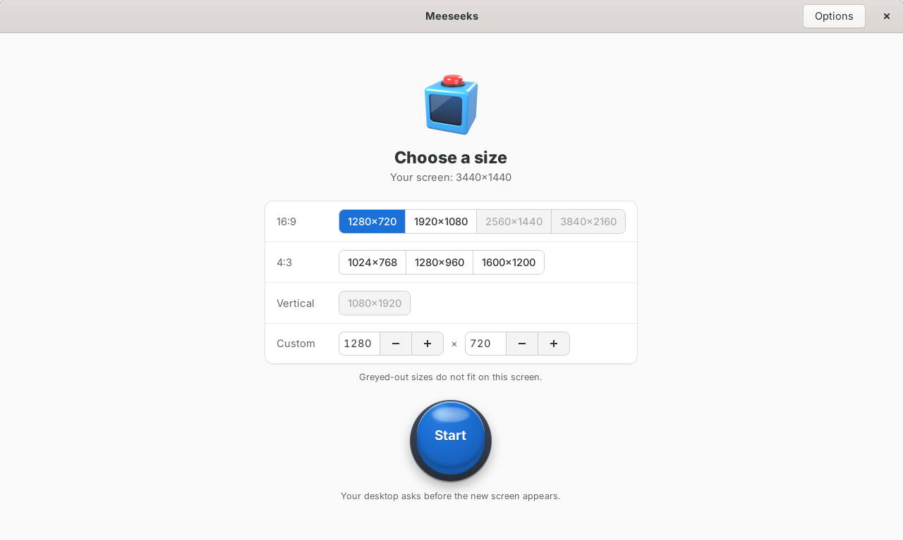

# Meeseeks

<!-- generated:status -->
0.9.0, tested on GNOME Wayland. KDE untested.
<!-- /generated:status -->

This README describes the latest release, not `main`.

[Download 0.9.0](#install), try it, and tell us [what breaks](https://github.com/Open-Breach/meeseeks/issues). [Opinions](https://github.com/Open-Breach/meeseeks/issues) welcome too, good or bad, as long as they're respectful.

## What it is

Meeseeks is a virtual second monitor for Linux. The system sees a real display; you see a window on your screen. Move the apps you want to show into it, then share or record that monitor. Everything else stays off camera.

## Why it exists

Remote work is everywhere now, and presenting in a meeting should be as little hassle as possible. I work on a big monitor; the people on the other end usually don't. That leaves two bad choices: share one window, or share the whole screen. Neither works for a product demo. You want to move between several windows, and sometimes the one you're demoing crashes. You restart it, and then you forget to share it again.

The same goes for screen recording: you want a fixed, sensible size and nothing else leaking into the video. Meeseeks gives you a second monitor you don't have to own. Put the demo on it, share it or record it, and carry on.

One caveat: Meeseeks reaches deep into the desktop, so it needs a few things in place and won't run everywhere. Check the requirements below before you try it.

## Features

- A virtual monitor your desktop treats as real, drawn in a window on your screen.
- Resolution presets (1920×1080 by default, 1280×720, 2560×1440, 3840×2160, vertical 1080×1920, a few 4:3) and custom sizes.
- Lock the window size, or let the window scale while the monitor keeps its resolution.
- An options dialog for the renderer and other tuning switches.
- Teleporter mode: click in the window and your pointer is on the virtual monitor.
- A screenshot button: the virtual monitor as a PNG at its exact resolution, saved to Pictures/Meeseeks.



## Requirements

<!-- generated:requirements -->
- **Wayland session.** X11 is not supported.
- **Desktop.** GNOME or KDE Plasma. On any other desktop Meeseeks warns and starts all the same.
- **PipeWire running.** The PipeWire daemon of your session.
- **xdg-desktop-portal.** With the backend for your desktop: xdg-desktop-portal-gnome or xdg-desktop-portal-kde.
- **ScreenCast portal with virtual monitors.** This is what makes the monitor. GNOME has it, and KDE Plasma from 6.5 on.
- **Remote control, for the teleporter.** Only teleporter mode needs it, and only GNOME is asked for it so far. Without it you still get the monitor.
- **GStreamer element pipewiresrc.** The GStreamer PipeWire plugin (Fedora: pipewire-gstreamer; Debian and Ubuntu: gstreamer1.0-pipewire; Arch: gst-plugin-pipewire).
- **GTK 4 renderer.** GL by default; the options have Vulkan and Cairo. If the one asked for does not start, GTK falls back to another and Meeseeks says so.
<!-- /generated:requirements -->

And one thing no check can tell you, because without it Meeseeks does not start at all: GTK 4.14, GStreamer 1.24 and glibc 2.39, or newer. Ubuntu 24.04, Fedora 40 with its updates and Debian 13 have them, and so does everything newer.

Tested on: Fedora 45, GNOME 51.1, Wayland.

Not sure? Just start Meeseeks. It checks each requirement and tells you what's missing.

## Install

<!-- generated:install -->
**Linux x86_64** · [meeseeks-0.9.0-linux-x64.tar.gz](https://github.com/Open-Breach/meeseeks/releases/download/v0.9.0/meeseeks-0.9.0-linux-x64.tar.gz)

```bash
tar xzf meeseeks-0.9.0-linux-x64.tar.gz && ./meeseeks-0.9.0-linux-x64/meeseeks
```

[Rick](https://github.com/Open-Breach/rick)'s tarball installer installs and uninstalls it in one click.

To build it from source, see [docs/building.md](docs/building.md).
<!-- /generated:install -->

## How to use it

Start Meeseeks, pick a resolution, press Start and confirm the dialog your desktop shows. From that moment your system has one more monitor. It appears in your display settings like any other, usually placed to the right of your real screen, and it behaves exactly like a physical one: push the mouse past the right edge and you're on it. The only difference is that it's drawn inside the Meeseeks window on your real screen. Drag the windows you want to show onto it, or launch them there.

Meeseeks also has a teleporter mode: click anywhere in the Meeseeks window and your pointer jumps to that spot on the virtual monitor. For it to work, allow remote control when the system asks; on GNOME that is the switch "Allow Remote Interaction" in the dialog at Start, and it is off by default. The click that takes you there is not passed on, so clicking something on the monitor takes a second click. During a demo this keeps you from getting sidetracked when the pointer slips off the edge.

Sharing in a meeting: in Zoom, Meet, Teams or whatever you use, share a screen, not a window, and pick the virtual monitor. *(pending: one line naming the monitor as it appears in the picker, once the GNOME rename result is known.)* Everything on it goes out; everything else stays private. Switch between apps on it as you like, and if one of them crashes, the share stays up.

Recording: in OBS or your recorder, add the virtual monitor as a screen source. You get a video at exactly the resolution you picked, with nothing else in the frame.

Done? Press Stop. The monitor disappears and the desktop moves any windows left on it back to your real screen.

> **Use with caution.** Meeseeks is written largely by an AI coding agent working from [SPEC.md](SPEC.md), with human review and testing on a real desktop. It is young software for Linux only, and it has run on a narrow set of desktops and distributions. The realistic risk is a crash or a setup where it won't start, not lost data: the only files Meeseeks writes are its settings and the screenshots you take. If it does something surprising, that's a bug: please report it.

## Join in

Meeseeks is open source under [Apache-2.0](LICENSE) and we want company.

- **Try it and tell us.** Open an [issue](https://github.com/Open-Breach/meeseeks/issues) for anything that crashes, looks wrong or is missing. Say which desktop and distribution you run, and paste what the terminal printed.
- **Tell us where it runs.** Meeseeks has been tested on one GNOME desktop so far. A report from KDE Plasma or from another distribution, working or not, is worth a lot.
- **Review the code.** Because so much of it is agent-written, a second pair of human eyes on any pull request is worth more here than in most projects.
- **Build something.** [docs/building.md](docs/building.md) takes you from a checkout to a running window, and [SPEC.md](SPEC.md) says what Meeseeks is and what it leaves out.

Contributions are accepted under the same Apache-2.0 license.

Licensed under [Apache-2.0](LICENSE).

<p align="center">
  
</p>
